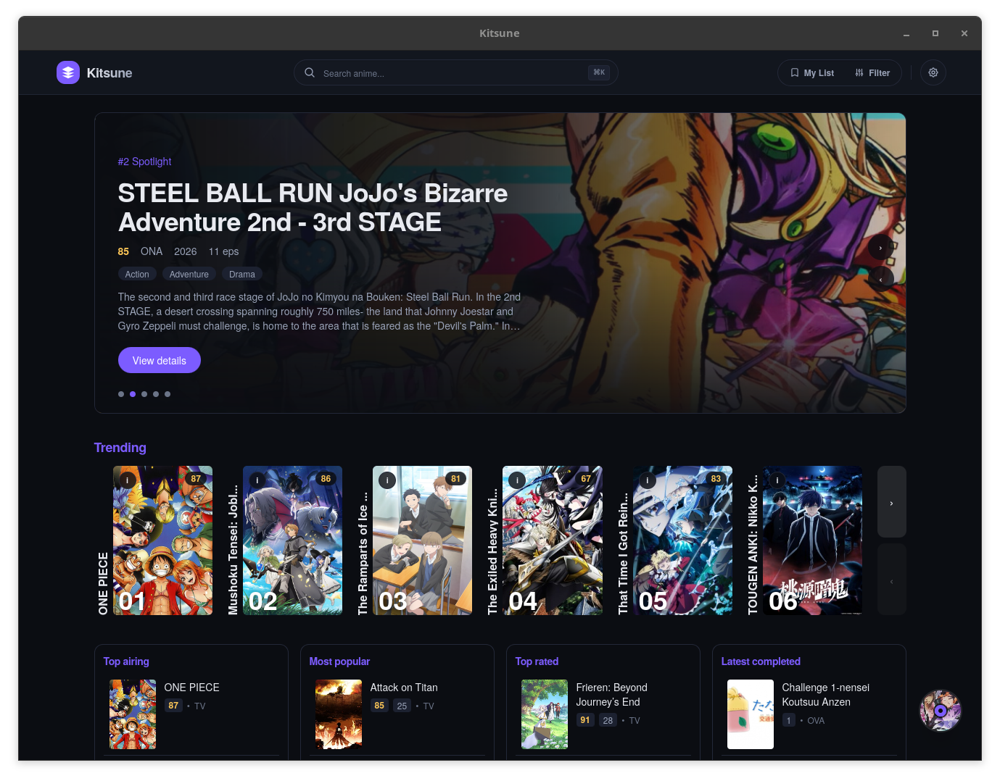
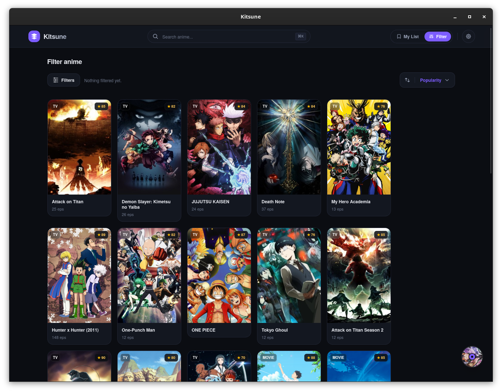
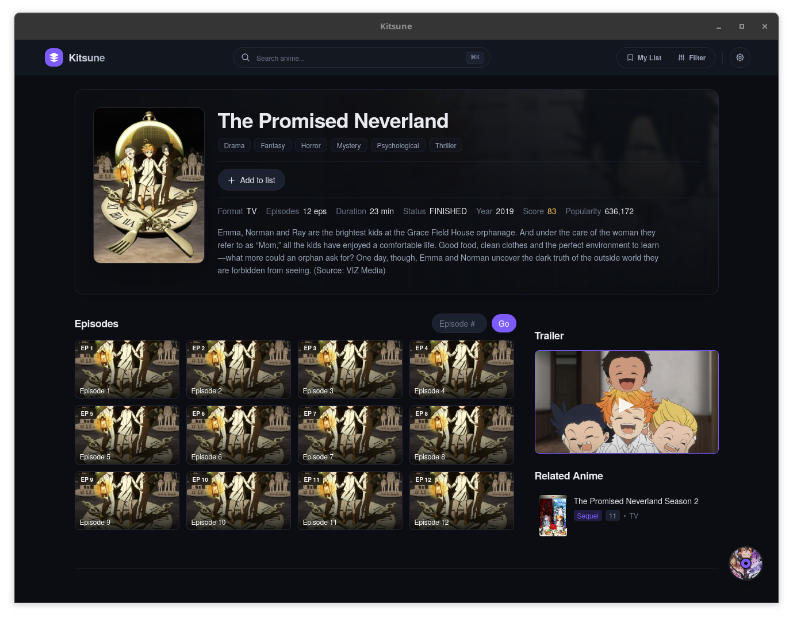
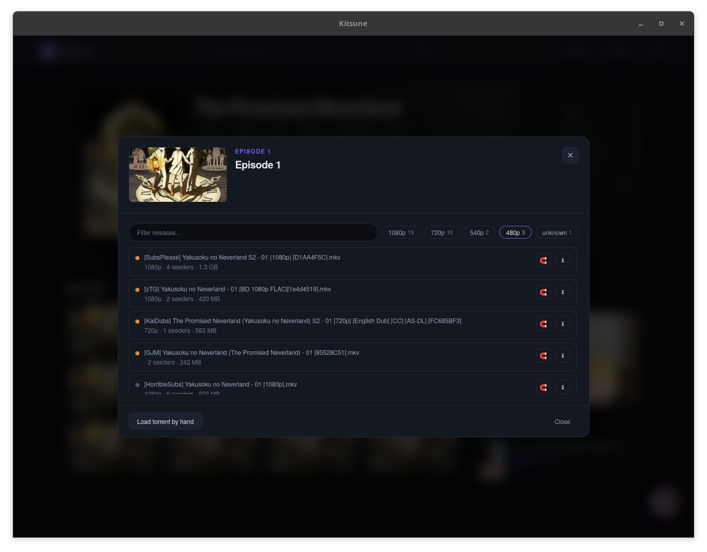
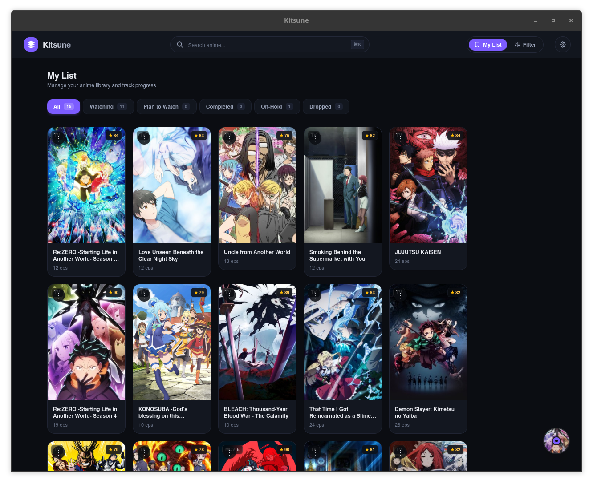
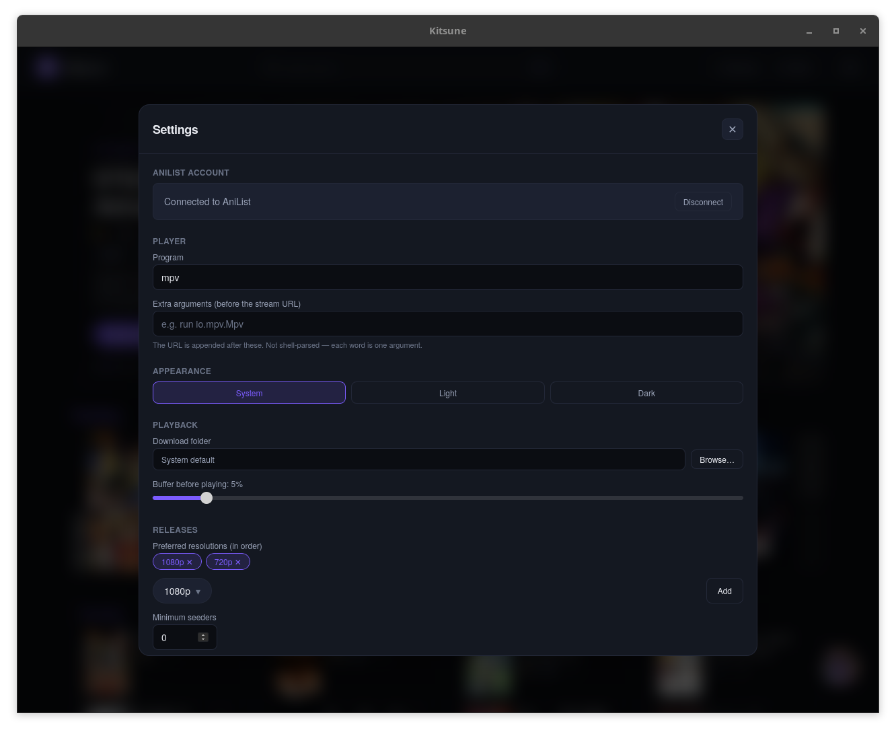

# Kitsune

A desktop anime streaming app. Kitsune browses and searches anime metadata
(powered by [AniList](https://anilist.co), with [Jikan](https://jikan.moe) for
episode lists), finds matching releases on [Nyaa](https://nyaa.si), and streams
them directly from torrents — without leaving the app.

Built with [Qt 6](https://www.qt.io/) + QML through
[CXX-Qt](https://kdab.github.io/cxx-qt/), with an embedded
[libmpv](https://mpv.io) video surface. The application logic is pure Rust in
`crates/kitsune-core`; the frontend is a thin QML layer on top of it.

## Install

Download the latest installer from the
[Releases page](https://github.com/AyoubToueti/Kitsune/releases/latest).

### Linux

Every release ships a portable AppImage, a Debian/Ubuntu `.deb`, and a
Fedora/openSUSE `.rpm`.

    # AppImage — runs on any distro
    chmod +x Kitsune_*_amd64.AppImage
    ./Kitsune_*_amd64.AppImage

    # Debian / Ubuntu
    sudo apt install ./kitsune_*_amd64.deb

    # Fedora / openSUSE
    sudo dnf install ./kitsune-*.x86_64.rpm

> The AppImage needs FUSE 2 to run. On newer distros where `libfuse2` is not
> installed, either install it (`libfuse2t64` on Ubuntu 24.04+) or run the
> AppImage with `--appimage-extract-and-run`.

Playback runs through an embedded libmpv, so `libmpv` must be installed
(`libmpv2` on Debian/Ubuntu, `mpv-libs` on Fedora).

### Windows

Run the `Kitsune_*_x64-setup.exe` from the Releases page. libmpv and the Qt
runtime are bundled, so no separate install is needed.

## Features

- **Discovery** — trending rails, curated shelves, top charts, and a genre grid.
- **Browse & filter** — search with filters for genre, season, year, format,
  status, and streaming resolution.
- **Detail pages** — synopsis, metadata, related/recommended titles, trailer
  cards, and external streaming links.
- **Torrent streaming** — searches [Nyaa](https://nyaa.si) for releases, then
  ranks them with a pipeline ported from
  [Sonarr](https://github.com/Sonarr/Sonarr) before playing them through
  [librqbit](https://github.com/ikatson/rqbit) with stream-health monitoring.
- **Local library** — continue-watching, watch progress, resume, and a
  per-title list status (watching / completed / planned / …).
- **External player** — hand a stream off to a local player such as
  [mpv](https://mpv.io).
- **AniList sign-in** — OAuth via a `kitsune://` deep link, with the token
  persisted across restarts.

## Screenshots

Drop PNGs into `docs/screenshots/` using the filenames below and they will
render. Suggested width: 1280px (the default window size).

| Home | Browse & filter |
| :--: | :-------------: |
|  |  |

| Detail page | Watch |
| :---------: | :---: |
|  |  |

| List page | Settings |
| :-------: | :------: |
|  |  |

## Project structure

    crates/
      kitsune-core/      the whole application, with no UI dependency
        providers/       AniList + Jikan + Kitsu metadata providers
        indexer/         torrent search: Nyaa transport + Sonarr-derived ranking
        torrent/         librqbit session management + the stream HTTP bridge
        player/          player state, watch position, last-played release
        downloads/       download records and on-disk layout
        list/            the reader's AniList list, with a local cache
        auth/            AniList token store + OAuth flow
        settings/        persisted settings store
        diagnostics/     logging, crash capture, process metrics, speed test
        tests/           `cargo test` integration tests (wiremock, librqbit)
      kitsune-qt/        Qt6/QML frontend (CXX-Qt + embedded libmpv)
        src/             the CXX-Qt bridge: every QML-visible command
        cpp/             C++ QML items: the mpv video surface, net cache, helpers
        qml/             pages, controls, dialogs, singletons
        packaging/       AppImage/deb/rpm and NSIS installer definitions
    docs/                player debugging notes
    scripts/             version propagation

## Getting started

### With Nix (recommended on NixOS)

The `flake.nix` dev shell provides the Rust toolchain, Qt 6 and libmpv, and
builds the merged Qt prefix that CXX-Qt needs on NixOS.

    nix develop

### Without Nix

Install Rust, a Qt 6.8+ development kit (with the Qt SVG module), CMake, Ninja,
`pkg-config` and the libmpv development files, then:

    cargo build -p kitsune-qt

Windows needs a slightly different libmpv setup, because the published mpv
builds ship a MinGW import library that MSVC cannot link. See
`crates/kitsune-qt/README.md` for the full recipe.

### Run in development

    cargo run -p kitsune-qt

The QML is compiled into the binary by `build.rs`, so there is no separate
frontend dev server.

### Build

    cargo build -p kitsune-qt --release

## Testing

    cargo test -p kitsune-core -p kitsune-qt

`smoke_stream` is `#[ignore]`d because it needs real content and network access:

    cargo test -p kitsune-core --test smoke_stream -- --ignored --nocapture

## Releasing

The version lives in one place: `[workspace.package] version` in the root
`Cargo.toml`. Both crates inherit it, and Cargo regenerates `Cargo.lock` from it.

    # bump it (also updates the two Cargo.lock entries)
    node scripts/sync-version.mjs 0.2.0

Then commit, tag, and push — the tag triggers the release workflow:

    git commit -am "release: v0.2.0"
    git tag v0.2.0
    git push origin main --tags

The tag **must** match the version; `qt-release.yml` derives the installer
version from the tag name and fails if it cannot.

## Credits

Kitsune stands on the work of others:

- **Metadata** — [AniList](https://anilist.co) (GraphQL API) and
  [Jikan](https://jikan.moe) (episode lists).
- **Torrent index** — [Nyaa](https://nyaa.si) (`nyaa.si`) for release search.
- **Release parsing & ranking** — the title/episode parser, normalizer, and
  release-ranking pipeline in `crates/kitsune-core/src/indexer/` are ported from the
  [Sonarr](https://github.com/Sonarr/Sonarr) project (specifically its
  `Parser`/`AnimeParser` and quality-resolution logic), adapted to the shapes
  anime indexers emit and re-implemented in Rust.
- **Torrent engine** — [librqbit](https://github.com/ikatson/rqbit).
- **Playback** — [libmpv](https://mpv.io) rendered into a Qt Quick
  framebuffer object.

## Recommended IDE setup

[VS Code](https://code.visualstudio.com/) + [rust-analyzer](https://marketplace.visualstudio.com/items?itemName=rust-lang.rust-analyzer)
+ the [Qt QML](https://marketplace.visualstudio.com/items?itemName=theqtcompany.qt-qml)
extension.

## License

MIT